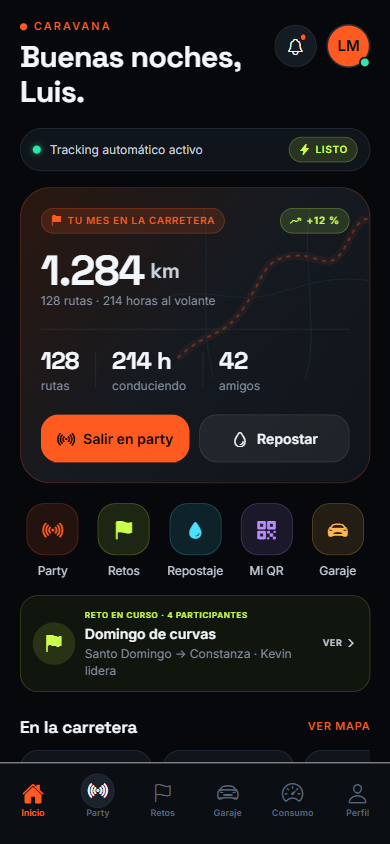
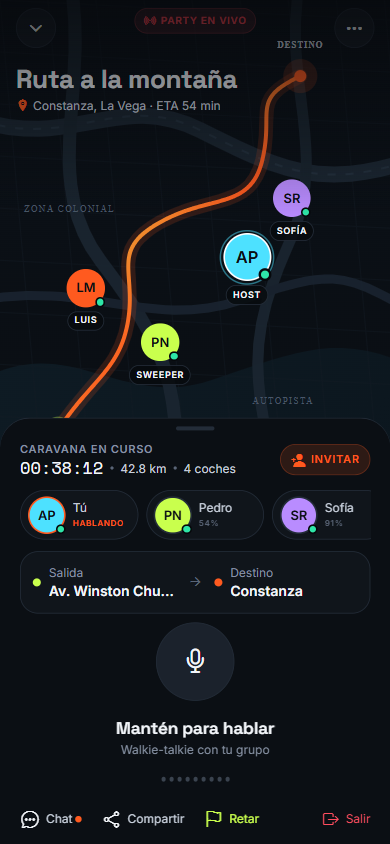
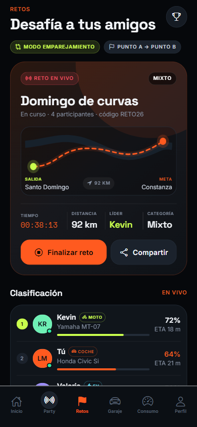
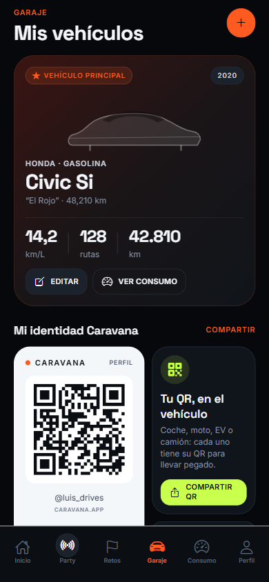
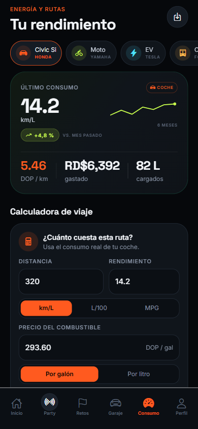
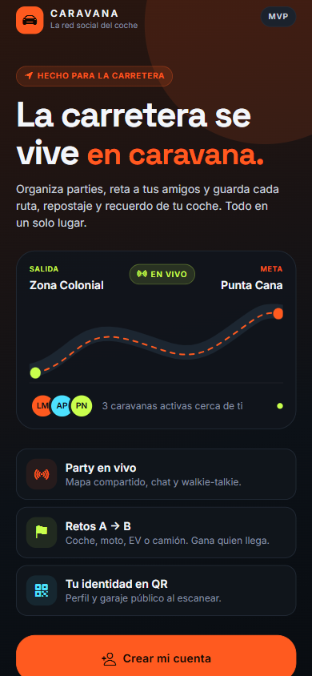
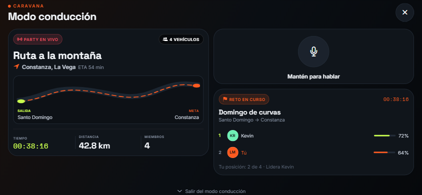
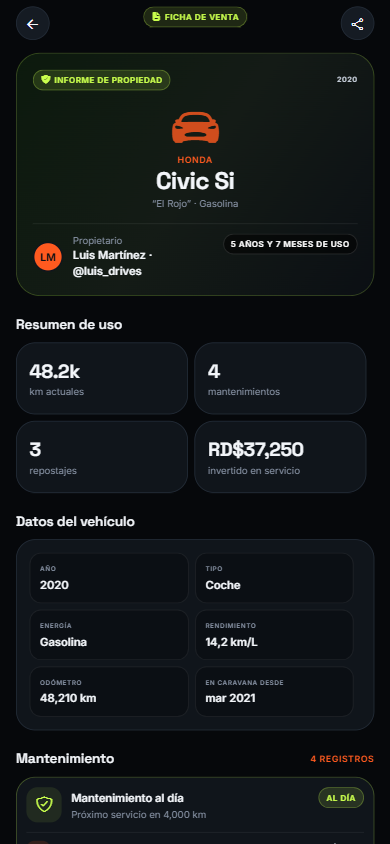
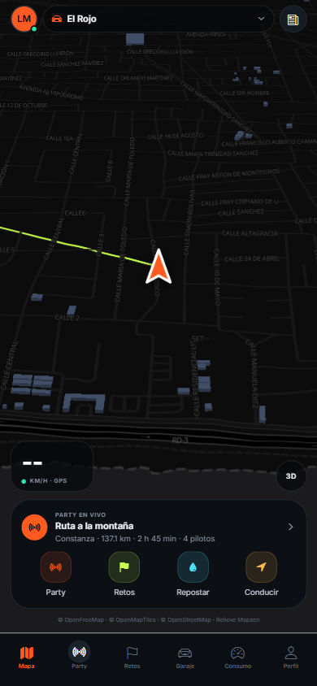

# Caravana — la red social del coche

Prototipo funcional de una app móvil que combina lo mejor de Wheelz con cuatro piezas propias:

1. **Party / caravana en vivo** — varios coches comparten el mismo viaje, se ven en el mapa, chatean y hablan por **walkie-talkie (push-to-talk)**.
2. **Retos punto A → B** — modo emparejamiento para desafiar a tus amigos; clasificación en vivo, código de invitación y **categorías separadas para coches, motos, vehículos eléctricos y camiones**.
3. **Combustible y energía** — repostajes de gasolina/diésel y cargas eléctricas: consumo real (km/L, L/100 km, MPG, kWh/100 km), costo por km, historial y **PDF**; inspirado en [`samilr/appFuelUsage`](https://github.com/samilr/appFuelUsage).
4. **QR de identidad** — cada usuario y cada vehículo (coche, moto, EV o camión) tienen un QR para llevar en el vehículo. Al escanearlo se abre el perfil público, sin instalar la app.

> **Nombre provisional:** Caravana. Todo el branding está centralizado para poder cambiarlo rápido.
>
> **Repositorio:** [github.com/Avismaelg/Aapp-Automovile](https://github.com/Avismaelg/Aapp-Automovile)

---

## Estado actual

Esto es un **MVP visual y funcional**, todavía no una app publicada. Las pantallas, la autenticación, el mapa real 3D, las parties, los retos y la capa de garaje/combustible ya están construidas; Supabase está conectado y migrado. Faltan LiveKit, progreso de retos por GPS y el build nativo.

| Módulo | Estado |
|---|---|
| Diseño dark + design system | ✅ |
| Autenticación email/contraseña | ✅ UI, validación, sesión persistida, rutas protegidas y registro real probado; faltan Apple/Google y recuperación |
| Eliminar cuenta y datos | ✅ confirmación `ELIMINAR`, Edge Function con `service_role`, borrado de Storage y cascada en Supabase; probado |
| Perfil editable + público | ✅ nombre, bio, ciudad y privacidad reales en Supabase; perfil público por `@usuario` y vehículos públicos |
| Amigos | ✅ búsqueda por nombre/@usuario, solicitudes, aceptar/rechazar y eliminar; demo con lista de ejemplo |
| Modo demo local | ✅ entra sin claves y conserva la sesión en el dispositivo |
| Feed social | ✅ publicaciones de texto y foto, likes, comentarios y visibilidad reales con Realtime; faltan guardados y moderación; demo con feed de ejemplo |
| Party / mapa en vivo | ✅ crear o unirse por código, miembros y posiciones reales por Supabase Realtime, chat en vivo, 3 canales de voz (Convoy/Ruta/Charla) y mapa 3D compartido; PTT real integrado con LiveKit, pendiente de secretos y prueba en dispositivos |
| Retos / emparejamiento | ✅ retos programados e instantáneos con invitación, aceptación, inicio, cronómetro, finalización e historial reales en Supabase + Realtime; ✅ demo local; ✅ retar a un compañero o a todo el convoy desde la party; 🟡 progreso por GPS y anti-trampas pendientes |
| Garaje multi-vehículo | ✅ coche, moto, EV y camión con QR; lectura y alta reales en Supabase + garaje demo persistente; ✅ foto del vehículo (bucket `vehicles`, recorte 4:3) en la tarjeta del garaje; falta edición de datos |
| Escáner QR | ✅ cámara nativa + fallback web |
| Perfil público por usuario y vehículo | ✅ datos técnicos, mantenimiento real en Supabase e historial de venta PDF; falta editar/eliminar mantenimientos |
| Combustible y energía | 🟡 gasolina/diésel + EV, PDF e historial; lectura/escritura base en Supabase; falta persistir el historial demo y editar registros |
| Modo conducción | ✅ pantalla grande y simplificada con party, PTT y reto; CarPlay/Android Auto nativos pendientes de build y aprobación |
| Tracking en segundo plano | 🟡 grabación de rutas con `expo-location` + `TaskManager` y servicio en primer plano; falta probar un recorrido largo real |
| Rutas y récords | ✅ viajes automáticos guardados en el dispositivo (distancia, duración, velocidad media y máxima), con indicador en el mapa; ✅ récords públicos de velocidad por tramo de autopista (top 3 + tu mejor marca); 🟡 faltan anti-trampas y editor de tramos |
| Supabase | ✅ proyecto `ecmqmgpruxclmpnnpgzv` conectado; Auth, perfil, amigos, garaje, combustible, mantenimiento, feed con fotos, retos, party y borrado de cuenta probados; 🟡 quedan `auth_rls_initplan` y políticas permisivas duplicadas para producción |
| Voz real (LiveKit) | 🟡 SDK web/nativo, 3 canales por party, Edge Function de tokens y PTT push-to-talk integrados; faltan secretos LiveKit y prueba de audio en dispositivos |
| Mapa 3D + GPS | ✅ pantalla **Inicio** personal estilo Waze (pestaña inicial del tab bar): MapLibre GL 3D, edificios y relieve, cámara que sigue posición y rumbo, vista 2D/3D y recentrar; rutas reales por calles (GraphHopper → OSRM → directa); búsqueda de destinos (Photon/OSM), ruta compartida por enlace `caravana://destino`; indicaciones giro a giro con distancia restante real, destinos recientes en Inicio, modo de videojuego a pantalla completa (ETA grande, banderas de checkpoint, flecha guía y frenado verde/amarillo/rojo); el coche 3D refleja tu vehículo; ✅ amigos con posición conocida aparecen en el mapa: al tocarlos se invitan al convoy o se retan; ✅ coche aparcado con línea guía, ruta de vuelta y modo caminando (muñeco peatón con el coche fijo en su sitio); 🟡 teselas vectoriales y motor de rutas propio pendientes para producción |
| 3D garage / clubs / meets | ⏳ fase 2 |

**Pantallas:** Bienvenida, Registro, Inicio de sesión, Mapa 3D, Actividad, Publicar, Amigos, Party, Retos, Garaje, Consumo, Perfil, Escáner, Modo conducción, invitación a party, invitación a reto, perfil público, ficha de venta del vehículo y perfil público de vehículo.

### Capturas

| Actividad | Party en vivo | Retos |
|---|---|---|
|  |  |  |

| Garaje multi-vehículo | Combustible y EV | Bienvenida |
|---|---|---|
|  |  |  |

| Modo conducción | Ficha de venta del vehículo |
|---|---|
|  |  |

| Mapa 3D con seguimiento del vehículo |
|---|
|  |

---

## Probarlo

Requisitos: Node 20+ y npm.

```bash
cd movil
npm install
npx expo start
```

- `w` → abre la versión web (útil para revisar el diseño).
- Escanea el QR de la terminal con **Expo Go** para verlo en el móvil.
- **Sin variables de entorno**, la app entra directo en modo demo. Para ver la
  bienvenida y los formularios: Perfil → Cuenta → *Salir del modo demo*.
- Con Supabase configurado, la app arranca en bienvenida y exige sesión para las
  pestañas. Los enlaces públicos de perfil, vehículo y reto siguen abriendo sin
  cuenta.
- **Retos:** Retos → elige ruta, categoría y modo → selecciona un amigo o usa
  “Elegir 2 aleatorios”. Con cuenta real, la invitación se guarda en Supabase,
  el amigo la acepta y el anfitrión inicia la salida. En demo se simula localmente.
- **Ficha de venta:** Garaje → abre un vehículo → *Preparar ficha de venta*.
- **Modo conducción:** Mapa → *Conducir* (funciona en horizontal y vertical).
- **Party real:** Party → crea una caravana con destino o únete con el código
  de un amigo. Las posiciones de los miembros y el chat se sincronizan por
  Supabase Realtime. Hay 3 canales de voz: Convoy, Ruta y Charla.
- **Voz real:** configura `LIVEKIT_URL`, `LIVEKIT_API_KEY` y
  `LIVEKIT_API_SECRET` como secretos de Supabase y despliega
  `livekit-token`. LiveKit requiere un development build/EAS, no Expo Go.
  Ver [`docs/12-livekit-voz.md`](docs/12-livekit-voz.md).
- **Mapa 3D:** es la pantalla inicial. Muestra edificios y relieve, y la cámara
  sigue la posición y el rumbo del vehículo, que se dibuja como coche 3D (con
  flecha de respaldo si Three.js no carga). Botones **3D/2D** y **recentrar**;
  al arrastrar el mapa se suelta el seguimiento. La Party usa el mismo motor 3D.
  Si no das permiso de ubicación, usa Santo Domingo como ubicación de demo. En
  web puedes conceder el permiso desde el navegador.
- **GraphHopper:** configura `EXPO_PUBLIC_GRAPHHOPPER_URL` o
  `EXPO_PUBLIC_GRAPHHOPPER_API_KEY` para rutas por carretera. Sin motor, la app
  usa una línea directa y lo indica en el mapa y en Party.
- El tracking en segundo plano y la cámara requieren un **development build**, no Expo Go:
  ```bash
  npx expo run:android
  # o en la nube (perfil preview = APK interno):
  npx eas-cli@latest build --profile preview
  ```

Comprobaciones:

```bash
cd movil
npx tsc --noEmit
npx eslint .
npx expo-doctor
```

---

## Supabase del proyecto

- Proyecto: `ecmqmgpruxclmpnnpgzv` (`https://ecmqmgpruxclmpnnpgzv.supabase.co`).
- Migraciones aplicadas: `init_caravana`, `fix_set_updated_at_search_path`,
  `vehicle_maintenance`, `challenge_mode`, `indexes_and_function_hardening`,
  `party_presence`, `party_voice_channels` y `post_media_storage`.
- 27 tablas en `public` con RLS activado.
- Auth email probado con usuarios temporales, ya eliminados.
- Garaje, repostaje, mantenimiento, amigos, feed de texto, retos y party reales
  probados con Supabase.
- `movil/.env` contiene la URL y la anon key; está ignorado por Git.
- **No** guardar la `service_role` en ninguna variable `EXPO_PUBLIC_*`.

El proyecto de Supabase está vinculado también al MCP de OpenCode para futuras
migraciones y consultas.

---

## Conectar Supabase

1. Crea un proyecto en [supabase.com](https://supabase.com).
2. Copia `movil/.env.example` a `movil/.env` y rellena:
   ```env
   EXPO_PUBLIC_SUPABASE_URL=https://xxxx.supabase.co
   EXPO_PUBLIC_SUPABASE_ANON_KEY=eyJ...
   ```
3. Aplica el esquema:
   ```bash
   cd movil
   npx supabase link --project-ref TU_REF
   npx supabase db push
   ```
   O pega `docs/03-modelo-datos.sql` en el SQL Editor.
4. Activa **Authentication → Providers → Email**. Para el MVP, desactiva
   **Confirm email** o configura la **Site URL** si vas a probar la confirmación
   en web. Apple y Google quedan para la siguiente fase.
5. Crea los buckets `avatars`, `vehicles`, `posts` y `receipts`.
6. Reinicia con `npx expo start --clear`.

El cliente está en `movil/src/lib/supabase.ts` y el estado de sesión en
`movil/src/store/auth.ts`. Si no hay variables de entorno, la app usa el modo
demo y sigue funcionando. El detalle del flujo, validaciones y pendientes está en
[`docs/05-autenticacion.md`](docs/05-autenticacion.md). La capa de garaje y
combustible está documentada en
[`docs/06-datos-garaje-combustible.md`](docs/06-datos-garaje-combustible.md).

---

## Conectar GraphHopper

Para rutas por carretera reales:

```env
# Servidor propio
EXPO_PUBLIC_GRAPHHOPPER_URL=http://localhost:8989
EXPO_PUBLIC_GRAPHHOPPER_PROFILE=car
```

o, usando la API cloud:

```env
EXPO_PUBLIC_GRAPHHOPPER_API_KEY=tu_api_key
```

El servidor local está en `infra/graphhopper/`; instrucciones completas en
[`docs/09-graphhopper.md`](docs/09-graphhopper.md). Si no hay motor configurado,
Party muestra una ruta directa y sigue funcionando.

---

## Estructura

```
app de auto/
├─ docs/
│  ├─ 01-producto.md          # visión, personas, alcance, roadmap, monetización
│  ├─ 02-arquitectura.md      # stack, flujos, seguridad, costes
│  ├─ 03-modelo-datos.sql     # esquema Supabase + RLS + Realtime
│  ├─ 04-checklist-mvp.md     # qué falta para lanzar
│  ├─ 05-autenticacion.md     # flujo de cuentas, Supabase y pendientes
│  ├─ 06-datos-garaje-combustible.md # capa de datos de garaje y energía
│  ├─ 07-carplay-android-auto.md # modo conducción y proyección nativa
│  ├─ 08-mapa-tiempo-real.md   # mapa 3D, cámara, GPS y party en vivo
│  ├─ 09-graphhopper.md        # rutas por carretera con GraphHopper
│  ├─ 10-retos.md              # flujo real de retos, RLS y Realtime
│  ├─ 11-party.md              # party real, posiciones, chat y RLS
│  ├─ 12-livekit-voz.md        # LiveKit, 3 canales y PTT real
│  ├─ 13-feed.md               # feed de texto/foto, likes y comentarios
│  ├─ 14-eliminar-cuenta.md    # borrado de cuenta, Storage y cascada
│  └─ 15-rutas-y-recordes.md   # rutas grabadas, segundo plano y récords por tramo
├─ infra/
│  └─ graphhopper/             # servidor Docker + extracto OSM
├─ movil/
│  ├─ app/                    # Expo Router (pantallas)
│  │  ├─ (auth)/              # Bienvenida, login y registro
│  │  ├─ (tabs)/challenges.tsx # Retos programados + reto al momento
│  │  ├─ challenge/[code].tsx  # Invitación a reto
│  │  ├─ drive.tsx             # Modo conducción
│  │  ├─ v/[slug].tsx          # Perfil público de vehículo
│  │  └─ v/[slug]/sale.tsx     # Ficha de venta con historial
│  ├─ src/components/         # UI, mapa, QR, PTT, feed, auth
│  ├─ src/hooks/              # perfil conectado
│  ├─ src/lib/                # Supabase, QR, combustible/EV, PDF, tracking
│  ├─ src/store/              # sesión, tracking y autenticación
│  ├─ src/data/mock.ts        # datos de la demo
│  ├─ scripts/generate_icons.py
│  └─ supabase/migrations/    # migración lista para `supabase db push`
└─ investigacion-competencia-wheelz.md
```

---

## Decisiones de producto ya tomadas

- **No clonar el garaje 3D de 300 coches en el MVP.** Primero foto + icono 2D; el 3D es fase 2 con packs descargables.
- **La voz es el diferenciador.** Wheelz no tiene PTT; una caravana real se coordina hablando.
- **Retos seguros, no carreras ilegales.** El reto mide llegada, nunca velocidad máxima, y muestra un aviso de conducción responsable. Las categorías de coche, moto, EV y camión compiten por separado; el modo mixto se resuelve por llegada.
- **Privacidad por defecto.** La ubicación solo se comparte dentro de una party; el QR no contiene teléfono ni ubicación.
- **Social gratis, memoria y herramientas de pago.** El plan Pro cobrará historial ilimitado, stats, 3D y PDF sin marca.
- **Español primero, LatAm/España después.** Soporte de DOP, USD, EUR, MXN y unidades métricas/imperiales.

---

## Lo que falta para producción

- Añadir guardados y moderación al feed.
- Apple/Google, recuperación de contraseña, cambio de `@usuario` y avatar.
- Añadir Presence y reconexión explícita a la party; las posiciones ya se sincronizan por Realtime.
- Elegir proveedor de teselas para producción y perfiles GraphHopper de moto/camión/EV.
- LiveKit Cloud + Edge Function de tokens: ya integrados; faltan secretos y
  prueba de audio real en dos dispositivos.
- Progreso de retos por GPS: salida/meta, distancia, llegada y anti-trampas.
- Detección de viajes con revisión/edición (unir, dividir, descartar).
- CarPlay/Android Auto nativos: entitlement de Apple, categoría de Android Auto, build nativo y aprobación de tiendas.
- Push notifications, moderación y analítica.
- Builds iOS/Android, TestFlight/Play Internal y 20–50 beta testers.

El detalle está en [`docs/04-checklist-mvp.md`](docs/04-checklist-mvp.md).

---

## Aviso

“Wheelz” es una marca de terceros. Caravana es un nombre provisional; antes de publicar hay que verificar disponibilidad de marca y dominio. Las funciones de velocidad se limitan a estadísticas privadas: no hay leaderboards de velocidad por seguridad y por las políticas de las tiendas.
