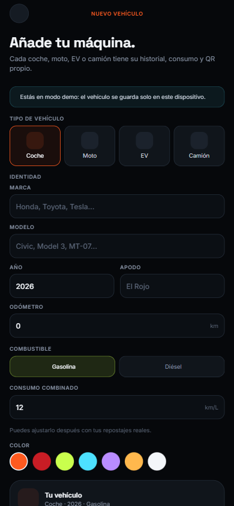

# Caravana — Datos de garaje y combustible

> Estado: capa de datos escrita para vehículos y repostajes. En modo demo usa
> almacenamiento local; con Supabase consulta y escribe las tablas reales.
> Estado: garaje, repostajes y mantenimiento probados contra el proyecto Supabase
> desplegado. Quedan edición/borrado y fotos de vehículo.

---

## 1. Fuente de datos

| Modo | Vehículos | Repostajes |
|---|---|---|
| Demo / sin claves | `src/data/mock.ts` + garaje local persistente | `src/data/mock.ts` + registros de la sesión |
| Supabase | `public.vehicles` del usuario | `public.fuel_logs` del usuario |

La decisión se toma con `account.mode` y `isSupabaseConfigured` en
`src/hooks/useGarage.ts` y `src/hooks/useFuelLogs.ts`.

---

## 2. Archivos

| Archivo | Responsabilidad |
|---|---|
| `src/hooks/useGarage.ts` | Consultar y crear vehículos; elegir demo o Supabase |
| `src/hooks/useFuelLogs.ts` | Consultar y crear repostajes/cargas |
| `src/lib/vehicle-db.ts` | Tipos de fila y mapeo DB ↔ UI |
| `src/store/demoGarage.ts` | Garaje demo persistido en `AsyncStorage` |
| `app/(tabs)/garage.tsx` | Garaje, QR por vehículo y estados vacíos |
| `app/vehicle/new.tsx` | Alta de coche, moto, EV o camión |
| `app/(tabs)/fuel.tsx` | Calculadora, guardado e historial |

---

## 3. Vehículos

### Lectura

Con Supabase:

```ts
supabase
  .from('vehicles')
  .select('*')
  .eq('owner_id', account.id)
  .order('is_primary', { ascending: false })
  .order('created_at', { ascending: true });
```

El mapeo a `Vehicle` rellena valores por defecto para año, apodo, color,
eficiencia y unidad. El QR usa el `qr_slug` generado por la base de datos.

### Alta

`app/vehicle/new.tsx` permite:

- tipo: coche, moto, EV o camión;
- marca, modelo, año, apodo y odómetro;
- combustible: gasolina, diésel o eléctrico;
- consumo en `km/L` o `kWh/100 km`;
- color (entre ellos negro);
- vehículo principal automático si es el primero.

### Foto del vehículo

En la tarjeta del garaje se toca la imagen (o el botón **Añadir foto**) para
elegir una foto de la galería: se recorta a 4:3, se sube al bucket de Storage
`vehicles` en `owner_id/vehicle_id/…` (solo el dueño puede escribir) y se guarda
la URL pública en `vehicles.photo_url`. En demo la foto se muestra local, sin
subir nada. Las miniaturas de la lista usan la foto si existe.

En Supabase se inserta en `public.vehicles` con `owner_id = auth.uid()`. Si se
marca como principal, primero se desmarca el anterior para respetar el índice
único `vehicles_one_primary_idx`.

En demo se crea un `qr_slug` local, se guarda el arreglo en
`caravana.demo.vehicles` y se conserva al recargar.



### Estados

- Cargando: indicador en Garaje y Consumo.
- Error de red: mensaje y botón de reintento.
- Sin vehículos: tarjeta para añadir el primero.
- Cuenta real sin vehículos: no se muestran los vehículos de la demo.

---

## 4. Repostajes y cargas

### Lectura

```ts
supabase
  .from('fuel_logs')
  .select('*')
  .eq('user_id', account.id)
  .order('filled_at', { ascending: false });
```

Cada fila se cruza con el vehículo correspondiente para saber si es combustible
o electricidad.

### Guardado

El formulario calcula litros o kWh, precio por unidad y coste total. Al guardar:

- en demo se crea un registro en memoria para la sesión;
- con Supabase se inserta en `public.fuel_logs` con `user_id = auth.uid()`;
- la lista se actualiza al instante y la consulta se invalida con TanStack Query.

### Convención de unidades

La columna `volume_l` guarda:

- litros para gasolina y diésel;
- kWh para vehículos eléctricos.

La ficha de venta usa estos registros, los mantenimientos y los datos del
vehículo para generar un PDF compartible:


El significado se deduce de `vehicles.fuel_kind`. Si en el futuro se mezclan
vehículos o se necesita reportería más estricta, conviene añadir una columna
`energy_kind` o `volume_kwh`.

---

## 5. Seguridad

- RLS activo en `vehicles` y `fuel_logs`.
- Cada usuario solo inserta/actualiza filas con su `auth.uid()`.
- Los vehículos públicos se pueden leer por QR según su privacidad.
- Los repostajes son privados: la política `fuel_logs_all` solo permite al dueño.
- El QR del vehículo contiene el `qr_slug`, nunca placa, odómetro ni ubicación.

---

## 6. Pendiente

- Editar/eliminar mantenimientos y adjuntar factura/foto del servicio.
- Añadir recordatorios de mantenimiento por push.
- Editar y eliminar vehículos.
- Subir foto del vehículo a Storage.
- Persistir el historial de repostajes en modo demo.
- Editar/eliminar repostajes y adjuntar recibo.
- Incluir el historial de viajes/rutas en la ficha de venta cuando el tracking suba datos.
- Calcular consumo real entre tanques llenos y mostrar alertas de mantenimiento.
- Sincronizar unidades y moneda con el perfil.
- Probar toda la capa contra un proyecto Supabase real.
- Añadir pruebas automatizadas de mapeo y validación.

---

## 7. Comprobaciones

```bash
cd movil
npx tsc --noEmit
npx eslint .
npx expo export --platform web
```

Prueba manual:

1. Modo demo → Garaje → Añadir → crear un EV.
2. Recargar la app: el EV debe seguir en el garaje.
3. Consumo → elegir el EV → Guardar carga → comprobar resumen e historial.
4. Con Supabase: crear cuenta, añadir vehículo y comprobar la fila en
   `public.vehicles`.
5. Guardar un repostaje y comprobar `public.fuel_logs`.
