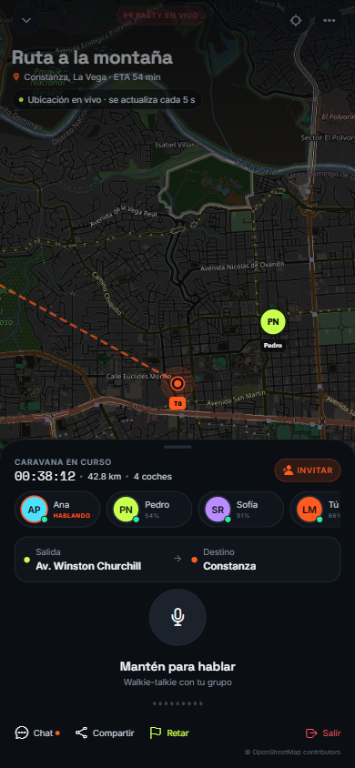

# Caravana — Mapa real y ubicación en tiempo real

> Estado: la pantalla de Party usa un mapa real de OpenStreetMap con la ubicación
> GPS del usuario actualizada cada 5 segundos. Los miembros y sus posiciones se
> sincronizan por Supabase Realtime; el chat también es real. El PTT de voz sigue
> pendiente de LiveKit.

---

## 1. Qué se implementó

- Mapa real gratuito con teselas de **OpenStreetMap** y renderizado **Leaflet**.
- Sin API key ni cuenta de mapas.
- Ubicación del usuario en vivo con `expo-location`:
  - permiso de ubicación en primer plano;
  - actualización cada 5 s o cada 5 m;
  - precisión y rumbo cuando el dispositivo los entrega.
- Fallback a Santo Domingo si el permiso se deniega o no hay GPS.
- Marcadores de la party con color, inicial y nombre.
- Destino y ruta A → B.
- Motor de rutas **GraphHopper** (cloud o self-hosted) con fallback a línea
  directa. Ver [`09-graphhopper.md`](09-graphhopper.md).
- Botón de recentrado sobre la posición del usuario.
- Atribución visible a OpenStreetMap.
- Funciona en web, iOS y Android:
  - web: `iframe` con Leaflet;
  - móvil: `WebView` con el mismo HTML.
- Tema oscuro mediante filtro CSS sobre las teselas de OSM.

Archivo principal: `movil/src/lib/map-html.ts`.
Componentes: `WorldMap.tsx` (nativo) y `WorldMap.web.tsx` (web).
Hook GPS: `src/hooks/useLiveLocation.ts`.

---

## 2. Flujo de ubicación

```
Party
  └─ useLiveLocation()
       ├─ requestForegroundPermissionsAsync()
       ├─ getLastKnownPositionAsync()
       ├─ watchPositionAsync(cada 5 s / 5 m)
       └─ fallback Santo Domingo si falla
  └─ usePartyLocation()
       └─ publica last_lat/last_lng/last_seen_at si el GPS está en vivo

WorldMap
  ├─ WebView / iframe con el HTML del mapa
  ├─ marcador "Tú" con la ubicación actual
  ├─ círculo de precisión
  ├─ miembros reales de la party con Realtime
  └─ destino + línea punteada
```

La ubicación del usuario se envía al mapa por `postMessage`; el HTML no se
recarga con cada actualización. Las coordenadas de los miembros se guardan en
Supabase mientras la party está activa y se limpian al salir.

---

## 3. Privacidad

- La ubicación se solicita solo al abrir Party/mapa.
- No se comparte con otros usuarios fuera de la party.
- Mientras hay una party activa, las coordenadas se guardan en Supabase y solo
  las pueden leer el anfitrión y los miembros.
- Al salir se borran `last_lat`/`last_lng` del miembro; el anfitrión puede cerrar
  la party.
- El QR público no contiene ubicación.
- Si el usuario niega el permiso, la app sigue funcionando con ubicación demo,
  pero **no publica** esa ubicación de demo en la party.

---

## 4. Límites actuales

- Las posiciones se sincronizan por Supabase Realtime; falta Presence explícita
  y reconexión para redes inestables.
- Las posiciones pueden quedar obsoletas si un miembro pierde conexión; falta
  mostrar la antigüedad y limpiar miembros inactivos.
- La ruta por carretera depende de GraphHopper configurado. Sin motor o si falla,
  se usa una línea recta geodésica y se avisa en Party.
- Las teselas se cargan directamente de `tile.openstreetmap.org`. Para una app
  con tráfico real hay que usar un proveedor de teselas o autohospedar OSM y
  respetar su política de uso.
- Leaflet se carga desde unpkg; en producción conviene empaquetarlo localmente.
- `react-native-webview` requiere un development build/EAS Build, no Expo Go.
- El tracking en segundo plano es independiente del mapa de Party.

---

## 5. Producción de mapas

Antes de lanzar:

1. Elegir proveedor de teselas:
   - MapTiler, Mapbox o Stadia para vector tiles;
   - servidor propio con OpenMapTiles/MapLibre.
2. Respetar atribución y límites del proveedor.
3. Evaluar MapLibre React Native para mapas vectoriales nativos.
4. Añadir navegación turn-by-turn.
5. Añadir Presence explícita y limpieza de miembros inactivos.
6. Probar batería, túneles, reconexión y precisión en dispositivos reales.

---

## 6. Pruebas

```bash
cd movil
npx tsc --noEmit
npx eslint .
npx expo-doctor
npx expo export --platform web
```

Prueba manual:

1. Abrir Party.
2. Conceder permiso de ubicación.
3. Comprobar el mensaje “Ubicación en vivo · se actualiza cada 5 s”.
4. Moverse o simular ubicación y verificar que el marcador “Tú” se mueve.
5. Pulsar el botón de recentrar.
6. Denegar el permiso: debe aparecer el fallback de demo y “REINTENTAR”.
7. Verificar la atribución de OpenStreetMap.


