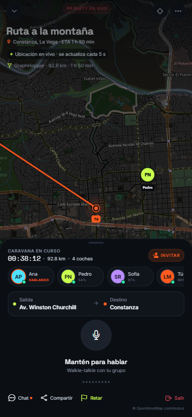

# Caravana — Rutas con GraphHopper

> Estado: Caravana ya calcula rutas por carretera con GraphHopper cuando hay un
> servidor o una API key configurada. Sin motor, el mapa usa una ruta directa y
> lo indica en pantalla.

---

## 1. Qué hace

- Calcula la ruta desde la ubicación GPS actual hasta la meta de la party.
- Dibuja la geometría real de la carretera en el mapa (no solo una línea recta).
- Muestra distancia y tiempo del motor.
- Actualiza la ruta cuando:
  - cambia el destino;
  - el usuario se mueve más de 250 m;
  - pasan más de 2 minutos desde el último cálculo.
- Si GraphHopper no está configurado o falla, mantiene el mapa funcional con
  una línea directa y un aviso.

---

## 2. Variables de entorno

En `movil/.env`:

### Servidor propio

```env
EXPO_PUBLIC_GRAPHHOPPER_URL=http://localhost:8989
EXPO_PUBLIC_GRAPHHOPPER_PROFILE=car
```

### API cloud

```env
EXPO_PUBLIC_GRAPHHOPPER_API_KEY=tu_api_key
EXPO_PUBLIC_GRAPHHOPPER_PROFILE=car
```

No definas `EXPO_PUBLIC_GRAPHHOPPER_URL` si usas la API cloud.

> Las variables `EXPO_PUBLIC_*` se incluyen en el bundle. Para producción, mueve
> la API key a una Edge Function o proxy propio.

---

## 3. Servidor local con Docker

El repositorio incluye:

```
infra/graphhopper/
├─ Dockerfile
├─ docker-compose.yml
├─ data/            # extracto OSM, ignorado por Git
└─ README.md
```

Arranque rápido:

```bash
cd infra/graphhopper
curl -L -o data/region.osm.pbf \
  https://download.geofabrik.de/central-america/haiti-and-domrep-latest.osm.pbf
docker compose up --build
```

Comprueba:

```bash
curl http://localhost:8989/health
curl "http://localhost:8989/route?point=18.4861,-69.9312&point=18.9095,-70.743&profile=car&points_encoded=false"
```

En un teléfono físico, `localhost` apunta al teléfono. Usa la IP LAN del
ordenador, por ejemplo `http://192.168.1.20:8989`, y abre el puerto en el
firewall. Para Android Emulator, usa `http://10.0.2.2:8989`.

> HTTP local sirve para desarrollo. En producción usa GraphHopper detrás de
> HTTPS o la API cloud.

---

## 4. Código

| Archivo | Función |
|---|---|
| `src/lib/graphhopper.ts` | Construye `/route`, valida la respuesta y convierte coordenadas |
| `src/hooks/useGraphHopperRoute.ts` | Recalcula con debounce y límites de distancia/tiempo |
| `src/lib/map-html.ts` | Dibuja la polilínea y el casing de la ruta |
| `WorldMap.tsx` / `WorldMap.web.tsx` | Envían la ruta al mapa por `postMessage` |
| `app/(tabs)/party.tsx` | Muestra estado, distancia y tiempo del motor |

La respuesta de GraphHopper usa `[longitud, latitud]`; la app la convierte a
`[latitud, longitud]` antes de pasarla a Leaflet.

---

## 5. Fallback y transparencia

Sin GraphHopper:

- el mapa sigue mostrando OpenStreetMap;
- la ruta es una línea punteada directa;
- Party muestra **“Ruta directa · configura GraphHopper”**;
- el resto de la party, el PTT y la ubicación GPS funcionan igual.

Si el motor falla durante una petición, se conserva una ruta directa y se muestra
“GraphHopper no disponible”.



> La captura se generó con un servidor de prueba local para validar la interfaz.
> La geometría real depende del extracto OSM y de la versión de GraphHopper
> desplegada.

---

## 6. Producción

- Alojar GraphHopper con HTTPS y un proxy inverso.
- Elegir perfil:
  - `car` para coches;
  - perfiles personalizados para moto, camión o EV.
- Añadir caché de rutas para no repetir peticiones.
- Limitar peticiones por usuario/dispositivo.
- Medir latencia y errores.
- Respetar la licencia de GraphHopper y los datos de OpenStreetMap.
- Para la API cloud, proxyficar la key y aplicar cuotas.
- Probar en dispositivos reales con red móvil, túneles y reconexión.

---

## 7. Pruebas

```bash
cd movil
npx tsc --noEmit
npx eslint .
npx expo-doctor
npx expo export --platform web
```

Prueba manual:

1. Sin configurar GraphHopper: Party debe mostrar ruta directa punteada.
2. Con servidor local: la línea debe seguir la carretera y mostrar distancia/tiempo.
3. Cambiar de ubicación más de 250 m: se debe recalcular.
4. Apagar el servidor: la app debe caer al fallback sin romperse.
5. Comprobar que el marcador “Tú” sigue actualizándose cada 5 s.
